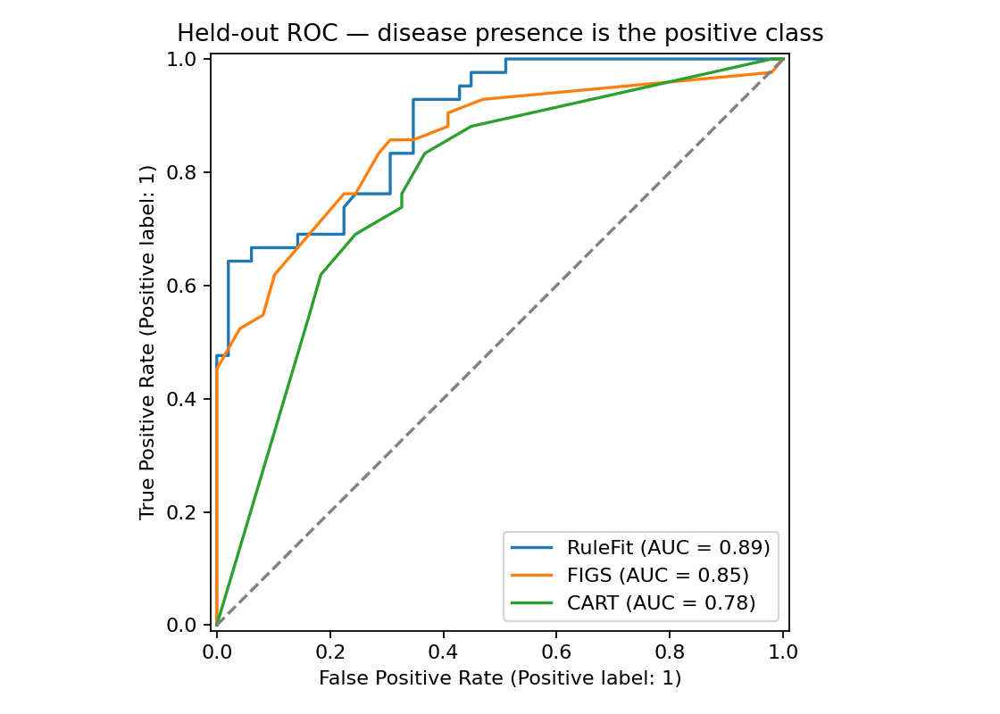
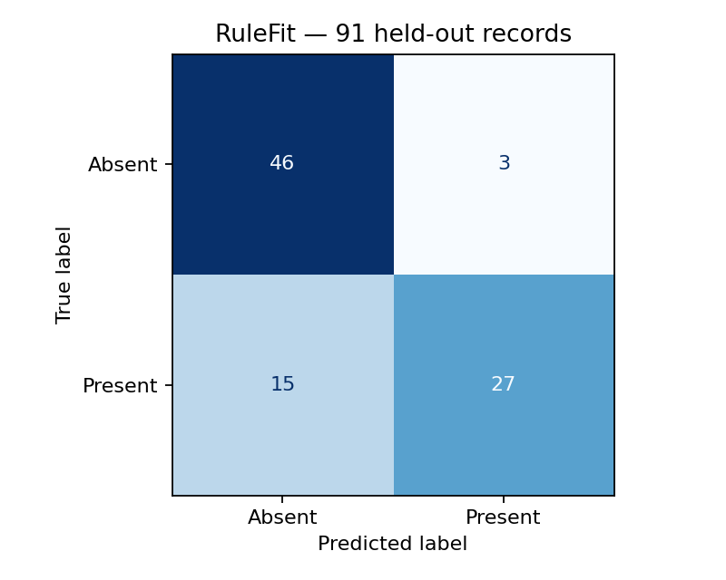
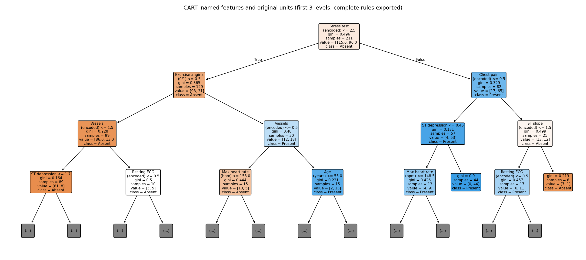

# Interpretable Heart Disease Classification

An educational comparison of RuleFit, FIGS and CART on Cleveland-derived records, with an explicit source-label audit.

## Critical label correction
All 303 bundled records were matched to the original UCI Cleveland data on eight unchanged measurements. **Bundled target=1 corresponds to absence (UCI num=0); bundled target=0 corresponds to presence (num>0).** The analysis therefore uses disease_present=1-target. This is disease-presence classification, not forecasting a future heart attack.

[Label audit](reports/label_audit.json) · [Data dictionary and coding mappings](DATA.md)

## Model comparison
| Model | Accuracy | Disease precision | Disease recall | Disease F1 | ROC-AUC | Train CV AUC mean | Train CV AUC std |
| --- | --- | --- | --- | --- | --- | --- | --- |
| Majority baseline | 0.5385 | 0.0000 | 0.0000 | 0.0000 | 0.5000 | 0.5000 | 0.0000 |
| RuleFit | 0.8022 | 0.9000 | 0.6429 | 0.7500 | 0.8875 | 0.8976 | 0.0075 |
| FIGS | 0.7692 | 0.7442 | 0.7619 | 0.7529 | 0.8540 | 0.8190 | 0.0313 |
| CART | 0.7253 | 0.7073 | 0.6905 | 0.6988 | 0.7770 | 0.8476 | 0.0551 |

One duplicate is removed before the stratified 70/30 split: 302 distinct rows, 211 training and **91 test records**. Seed 42, threshold 0.5. Three-fold stratified CV is confined to training data. Fixed model settings are used. These updated results replace the earlier coursework outputs; the corrected target, deduplication and split are documented in [run metadata](reports/run.json).

Missing mirror codes ca=4 and thal=0 are converted to missing values and imputed inside each training fold. Library RuleFitClassifier replaces the unused custom implementation. Inputs retain original units and named features.





Readable RuleFit, FIGS and CART rule exports are in [reports/](reports/). Small-sample validation and disease recall matter alongside AUC; these results do not establish clinical validity.

## Run
```bash
git clone https://github.com/YirenShen-07/HeartDiseaseModels.git
cd HeartDiseaseModels
python -m venv .venv
# macOS / Linux:
source .venv/bin/activate
# Windows PowerShell: .venv\Scripts\Activate.ps1
python -m pip install -r requirements.txt
python verify_labels.py
python analyze.py
```
Tested with Python 3.12. Modeling reads the bundled heart.csv directly; no Drive or course-template directory is needed. Source audit downloads the original UCI file. [Notebook](interpretable_heart_disease.ipynb) · [DATA.md](DATA.md).

## Project context
Original Duke AIPI 590 model-comparison project by Yiren Shen, updated with AI-assisted reproducibility and label corrections in 2026. This is a teaching exercise, not a validated clinical tool.
